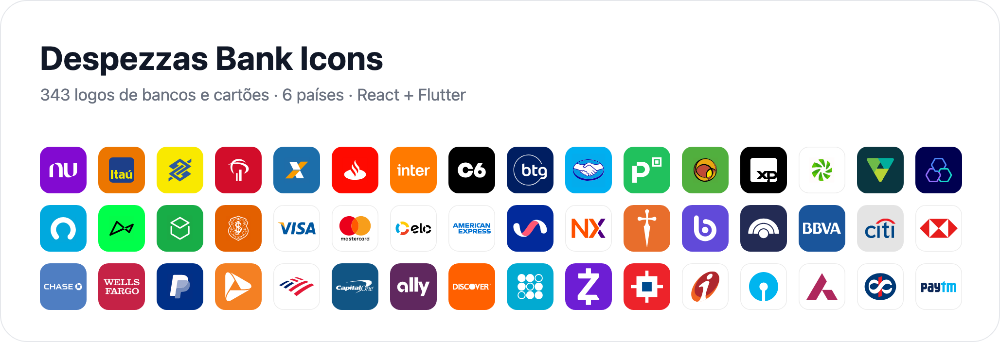

<p align="center"></p>

# Despezzas Bank Icons

Os logos de bancos e cartões do Despezzas em azulejos quadrados (SVG 64×64, cantos de raio 14), com pacotes para **React** (web) e **Flutter** (app) gerados da mesma fonte.

| Pacote | Pasta | Documentação |
|---|---|---|
| `@despezzas/bank-icons` | `packages/react` | [packages/react/README.md](packages/react/README.md): instalação via git, uso, busca pelo nome e catálogo |
| `despezzas_bank_icons` | `packages/flutter` | [packages/flutter/README.md](packages/flutter/README.md) |

```tsx
import { NubankLogo } from '@despezzas/bank-icons';
import { findBankLogo } from '@despezzas/bank-icons/all';
<NubankLogo size={32} />
```

```dart
DzBankLogo('nubank', size: 32)
DzBankLogo.find('Banco do Brasil')
```

Abra `preview/index.html` para ver todos os logos (claro e escuro) e copiar o nome do componente.

## Estrutura

```
catalog.json            bancos: slug, URL antiga do logo, nomes e países (fonte da verdade)
source/                 logos originais (redondos), baixados por `npm run fetch`
overrides.json          ajustes por banco para o gerador (escala, fundo, recorte…)
manual/<slug>.svg       azulejo feito à mão; vence o gerador
svg/                    azulejos quadrados gerados por `npm run square` (+ manual/)
scripts/fetch.mjs       catalog.json → source/
scripts/square.mjs      source/ → svg/ (mede no Chrome headless com scripts/measure.js)
scripts/sheet.mjs       folhas de revisão em build/sheets (claro, escuro, antes/depois)
scripts/build.mjs       svg/ → pacotes, dist/svg, preview e READMEs
scripts/png.mjs         assets/banner.png e assets/catalog.png (imagens dos READMEs)
packages/react/         @despezzas/bank-icons (dist/ gerado e versionado)
packages/flutter/       despezzas_bank_icons (lib/src/bank_logos.g.dart gerado e versionado)
dist/svg/               SVGs estáticos
docs/README.*.md        templates dos READMEs dos pacotes
```

Os arquivos gerados são versionados de propósito: os apps consomem o repositório direto pelo git, sem etapa de build.

## Como o azulejo é feito

O logo original (círculo da cor da marca + marca por cima) vira um quadrado sem redesenhar nada:

1. O fundo é detectado: a forma que cobre o círculo inteiro (círculo, quadrado ou path do tamanho do viewBox). Vira `<rect width="64" height="64" rx="14">` na mesma cor (gradientes mantidos). Fundo vazado (marca recortada no círculo) vira fundo + os recortes em branco.
2. Sem fundo, ou fundo branco/quase branco: azulejo branco com contorno fino (`#000` a 8%), visível em telas claras.
3. Clip-paths e máscaras que só recortavam no círculo saem; os que cortam a marca ficam.
4. A marca é centralizada e escalada: com fundo, mantém o tamanho do original ×1.08; sem fundo, é normalizada pela área. Teto de tamanho óptico e no mínimo 6 unidades até a borda.
5. Ids ganham o prefixo `dzb-<slug>-`; scripts, imagens raster, handlers e links externos são removidos; números arredondados.

## Adicionar ou corrigir um banco

1. Adicione a entrada em `catalog.json` (`slug` kebab-case, `source` com a URL do logo, `names` com o nome de exibição primeiro e os apelidos, `countries`).
2. `npm run fetch` (baixa o que falta em `source/`; `--force <slug>` baixa de novo).
3. `npm run square` e `npm run sheet`; revise `build/sheets/compare-*.png`.
4. Ficou errado? Ajuste em `overrides.json` (`scale`, `offset`, `background`, `knockout: false`, `drop`…; a lista está no `$comment`) ou desenhe `manual/<slug>.svg` (viewBox `0 0 64 64`).
5. `npm run build`, `npm run png` se o catálogo mudou, e `npm test`.

## Licença

© Despezzas. Todos os direitos reservados. Os logos são marcas registradas das respectivas instituições.
